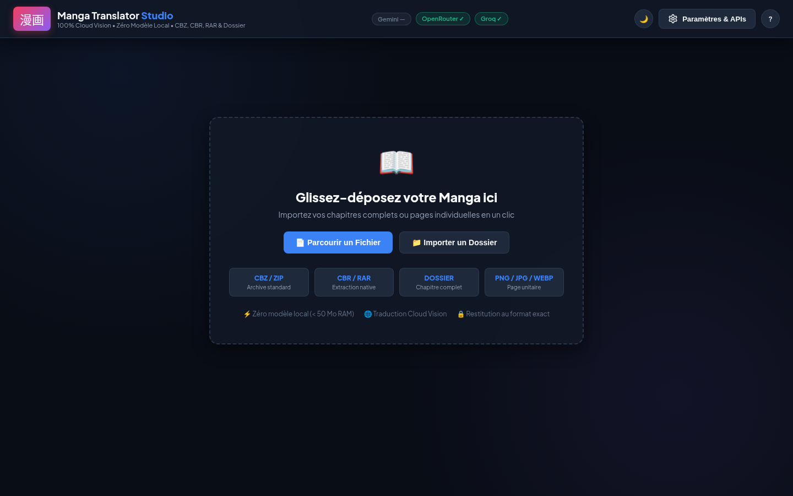
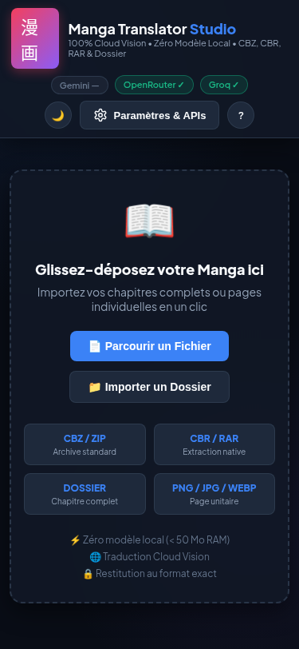
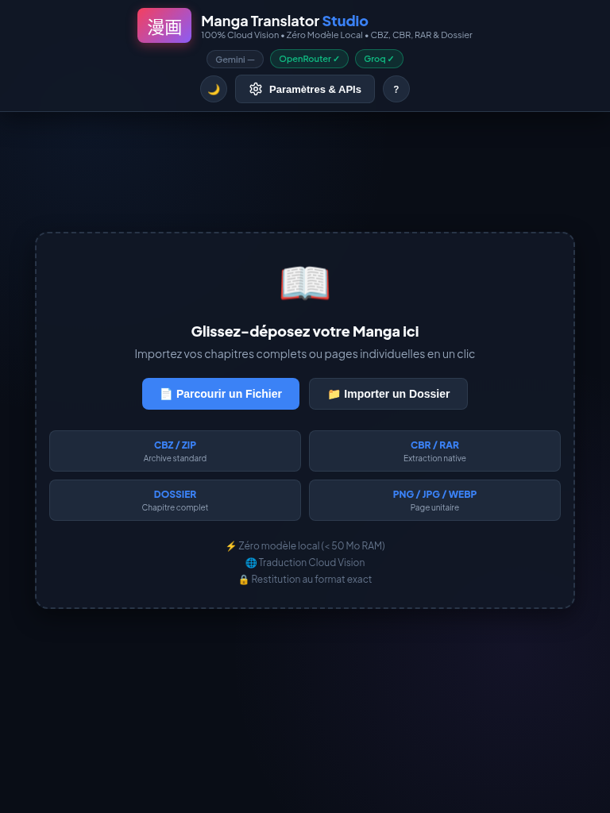

# 📖 Manga Translator Studio (100% Cloud Vision & Scanlation Pro)

Application Web moderne de traduction automatique de mangas et comics conçue pour fonctionner avec **zéro modèle neuronal local** (`< 90 Mo` de RAM au repos, aucun GPU requis). Toute l'intelligence visuelle (OCR + Traduction contextuelle) est déléguée aux APIs Cloud gratuites ou personnalisées.



---

## ✨ Fonctionnalités Principales

### 1. Qualité « Scanlation Pro »
- **Masquage Intelligent des Bulles (`smart`)** :
  - Analyse locale d'histogramme C-accélérée (`Pillow`) sur chaque boîte (+8 % de marge).
  - **Préservation des contours de bulles** : détection des composantes connexes reliées au bord pour effacer uniquement les traits d'encre internes (texte source) avec dilatation morphologique (`MaxFilter(5)`) et adoucissement (`GaussianBlur(1.2)`) sans jamais mordre sur le cadre noir de la bulle.
  - **Détection automatique Fond Clair / Fond Sombre / Trame (Screentone)** : les boîtes de narration noires ou sombres (`médiane < 128`) sont nettoyées en sombre et composées automatiquement en texte blanc (`#FFFFFF`) avec contour de sécurité.
- **Typographie Manga en Losange (Diamond Word-Wrap)** :
  - Programmation dynamique équilibrant la largeur des lignes selon un profil ovale/losange et évitant les mots orphelins en fin de bulle.
  - Règles typographiques françaises automatiques (espaces insécables avant `!`, `?`, `:`, `;` et dans `« … »`).
  - Marge interne garantie de 11 % de chaque côté.
- **Continuité Contextuelle Inter-Pages & Raffinement Groq** :
  - Conserve les 8 dernières répliques traduites d'une page à l'autre pour harmoniser les noms propres, le genre et le tutoiement/vouvoiement.
  - Raffinement systématique de toutes les bulles de la page par **Groq** (`qwen/qwen3.8-27b`) lorsqu'une clé Groq est configurée.
- **Éditeur de Bulles en Direct** :
  - Panneau latéral repliable **« 💬 Bulles détectées »** permettant de modifier le texte traduit de n'importe quelle bulle et de régénérer la planche instantanément via `POST /api/rerender/{session_id}/{page_idx}` sans rappeler l'API Vision.

### 2. Liseuse Interactive & Formats Universels
- **Formats supportés en entrée et sortie** : `.cbz`, `.cbr`, `.rar`, `.zip`, **Dossiers complets** (`webkitdirectory`), et **Images seules** (`.png`, `.jpg`, `.webp`).
- **3 Modes de lecture** :
  1. **Côte à côte (Split-View)** : Original à gauche, Traduit à droite.
  2. **Page unique** : Bascule instantanée Original / Traduit.
  3. **Slider Avant / Après interactif** : Curseur glissable (`clip-path`) superposant la planche originale et la planche traduite.
- **Outils de confort** : Thème Clair / Sombre persistant, Zoom (`50%` à `250%` + `Ctrl + Molette`), Mode Plein Écran (`F`), raccourcis clavier (`←`/`→`, `1`/`2`/`3`), retraduction d'une page isolée, annulation en cours de tâche et estimation du temps restant (ETA).

---

## 🚀 Installation & Lancement en 1 Clic

### Prérequis
- Linux / macOS / Windows (WSL) avec **Python 3.12+**
- Outils d'archives système optionnels pour le format `.cbr`/`.rar` : `unrar` ou `7z`

### Démarrage rapide
```bash
git clone <url-du-depot>
cd traducteur
./lancer_manga_translator.sh
```
Le script crée/utilise l'environnement virtuel, démarre le serveur local sur `http://127.0.0.1:8000` et ouvre automatiquement votre navigateur.

Vous pouvez également double-cliquer sur le raccourci Bureau **`Manga Translator Studio`**.

---

## 🔑 Configuration des Clés d'API

Copiez le fichier d'exemple ou configurez vos clés directement depuis le bouton **⚙️ Paramètres & API** de l'interface Web :
```bash
cp .env.example .env
```

| Fournisseur | Variable `.env` | Usage |
| :--- | :--- | :--- |
| **Google Gemini** | `GEMINI_API_KEY` | Vision + Traduction (1500 req/jour gratuites via Google AI Studio) |
| **OpenRouter** | `OPENROUTER_API_KEY` | Modèles Vision gratuits (`google/gemma-4-31b-it:free`, `nvidia/nemotron-3.5-super-vl:free`, etc.) |
| **Groq** | `GROQ_API_KEY` | Polissage ultra-rapide des dialogues en français naturel (`qwen/qwen3.8-27b`) |
| **Ollama Cloud / NVIDIA NIM** | `OLLAMA_API_KEY` / `NVIDIA_API_KEY` | Fournisseurs Cloud Vision de repli automatique |
| **Custom OpenAI** | `CUSTOM_BASE_URL`, `CUSTOM_API_KEY`, `CUSTOM_MODEL` | Tout serveur compatible OpenAI Vision (`/v1/chat/completions`) |

---

## 🧪 Tests Automatisés

La suite de tests `pytest` (33 tests unitaires et d'intégration) vérifie le parseur JSON, la désambiguïsation des coordonnées bbox, la matrice 4×4 du typesetter, le masque intelligent (`smart`), le raffinement Groq, l'extraction/recompression d'archives et tous les endpoints FastAPI :

```bash
./venv/bin/pytest tests/ -q
```

---

## 📱 Aperçu Responsive (Mobile, Tablette, Desktop)

| Mobile (`375px`) | Tablette (`768px`) | Desktop (`1440px`) |
| :---: | :---: | :---: |
|  |  |  |

---

## 📄 Licence

Distribué sous licence [MIT](LICENSE).
