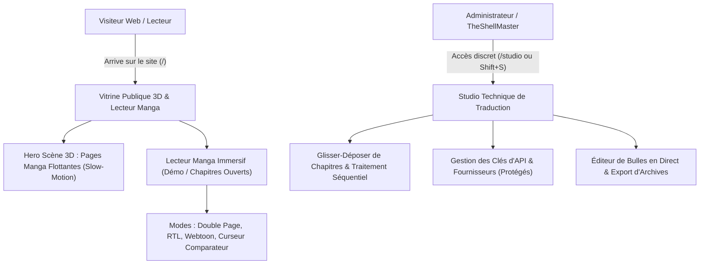

# 📖 Manga Translator Studio — Architecture, Vision & Agent Handoff

> **Plateforme moderne de Scanlation Manga & Manhwa (100% Cloud Vision, Zéro modèle local, Empreinte RAM < 50 Mo)**  
> *Conçu et développé en pair-programming par **TheShellMaster** et l'agent **Antigravity** (Google DeepMind).*

---

## 🧭 Note d'Intention & Message pour l'Agent Externe (Handoff)

Cher agent collaborateur, ce document récapitule l'état réel du projet, la stack technique, les pièges résolus et la roadmap exacte pour les prochaines étapes.

Le projet a traversé plusieurs itérations d'agents dont certaines ont causé des dégâts majeurs (troncature involontaire de fichiers, modèles IA inventés, fuites de clés en clair). Nous venons de restabiliser l'intégralité du socle : **112 tests automatisés passent désormais au vert (0 échec)**.

Voici notre vision commune et les directives prioritaires pour poursuivre le chantier.

---

## 🏗️ 1. La Stack Technique Complète

```text
┌────────────────────────────────────────────────────────────────────────┐
│                        ARCHITECTURE DU PROJET                          │
├────────────────────────────────────────────────────────────────────────┤
│                                                                        │
│   [ Interface Web / Visiteur ]        [ Studio Privé / Admin ]         │
│   • Vitrine 3D Slow-Motion            • Import CBZ / CBR / Dossiers    │
│   • Lecteur Manga RTL / Webtoon       • Détection & Retouche Bulles    │
│   • Comparateur Avant / Après         • Suivi Page par Page en Direct  │
│                   │                                 │                  │
│                   └────────────────┬────────────────┘                  │
│                                    ▼                                   │
│                     FastAPI Backend (server.py)                        │
│                     • Monoprocessus ultraléger (< 50 Mo RAM)           │
│                     • File d'attente atomique (statut 'queued')        │
│                     • Protection CSRF & Masquage des secrets           │
│                                    │                                   │
│            ┌───────────────────────┼────────────────────────┐          │
│            ▼                       ▼                        ▼          │
│    app/archives.py        app/cloud_vision.py      app/typesetter.py   │
│    • CBZ, CBR, ZIP, RAR   • Gemini 2.0 / 1.5 Flash • Inpainting en C   │
│    • Tri naturel          • OpenRouter / NVIDIA    • Losange (DP Wrap) │
│    • ComicInfo.xml        • Groq Llama 3.3 Refine  • Polices TrueType  │
│                                                                        │
└────────────────────────────────────────────────────────────────────────┘
```

### Backend (`server.py`)
- **FastAPI / Uvicorn** : Monoprocessus léger, zéro fuite mémoire, résilient aux coupures avec watchdog heartbeat d'auto-extinction propre (`MTS_AUTO_EXIT`).
- **Sessions & Cache** : Suivi d'état mémoire atomique avec verrou `_session_state_lock`, persistance de l'historique dans `data/history/sessions.json`, et cache SHA-256 des pages pour éviter de réinterroger les APIs pour une page déjà traduite.

### Moteur de Vision & Traduction (`app/cloud_vision.py`)
- **100% Cloud Vision (Zéro modèle lourd local)** : Aucun GPU requis, aucune dépendance lourde (`torch`, `tesseract`, `onnxruntime` sont strictement proscrits).
- **Fournisseurs Supportés** :
  - **Google Gemini** : `gemini-2.0-flash`, `gemini-2.0-flash-lite`, `gemini-1.5-flash` (quota généreux de 1 500 requêtes/jour gratuites).
  - **OpenRouter** : `nvidia/nemotron-3.5-super-vl:free`, `qwen/qwen2.5-vl-72b-instruct`.
  - **NVIDIA NIM** : `meta/llama-3.2-11b-vision-instruct`, `nvidia/nemotron-3.5-super-vl-120b-a12b`.
  - **Groq LPU** : `llama-3.3-70b-versatile`, `llama-3.1-8b-instant` (relecture stylistique ultra-rapide).
  - **Endpoint Personnalisé (OpenAI-compatible)** : Local Ollama, vLLM, LMStudio.

### Typographie & Nettoyage Manga (`app/typesetter.py`)
- **Smart Bubble Inpainting (pur C via Pillow)** : Analyse d'histogramme, seuillage adaptatif selon la luminance du fond (sombre vs clair) et détection des composantes connexes périphériques pour **effacer le texte japonais sans jamais effacer le contour noir de la bulle**.
- **Diamond Word-Wrap (Programmation Dynamique)** : Algorithme équilibrant le nombre de mots par ligne pour épouser le profil ovale des bulles de manga, avec interdiction absolue des mots orphelins sur la dernière ligne et respect strict de la ponctuation française (`\u00A0` insécable avant `!`, `?`, `:`, `;` et dans `« … »`).

### Gestion Universelle des Archives (`app/archives.py`)
- Extraction et recompilation fidèle de chapitres entiers : **CBZ, CBR, ZIP, RAR, dossiers d'images et planches unitaires**.
- Tri naturel strict (`001.jpg`, `002.jpg`, `010.jpg`), assainissement anti Zip-Slip et conservation inviolée des métadonnées `ComicInfo.xml`.

---

## 🔍 2. Problèmes Détectés et Corrigés (Le Bilan de l'Audit)

Les agents précédents ont commis plusieurs erreurs critiques qui ont été corrigées :

1. **L'Illusion du Parallélisme Multi-Pages** :
   - *Le problème* : Vouloir traduire 3 ou 4 pages simultanément sur des quotas gratuits menait à l'échec immédiat (erreurs HTTP 429 Too Many Requests) et brisait la cohérence narrative (le modèle traduisait la page 2 sans connaître les répliques de la page 1).
   - *Le correctif* : **Traduction strictement séquentielle par défaut (`concurrency = 1`)**, transmission du contexte de dialogue de page en page (`context_history`), et temporisation intelligente avec jitter backoff en cas de saturation temporaire d'un fournisseur.
2. **Élimination des Modèles Hallucinés** :
   - *Le problème* : Des noms de modèles fictifs (`qwen/qwen3.8-27b`, `gemma4:31b`, `gemini-2.5-flash`) avaient été inscrits dans le code, faisant planter le raffineur Groq et le fallback Gemini.
   - *Le correctif* : Modèles alignés sur les catalogues réels officiels (`llama-3.3-70b-versatile` sur Groq, `gemini-2.0-flash` sur Google).
3. **Sécurisation des Secrets & Isolation** :
   - *Le problème* : `GET /api/settings` renvoyait les clés API en clair dans le JSON.
   - *Le correctif* : Masquage total des clés dans les réponses de l'API (seul le booléen `configured[provider]` est exposé) et protection contre les requêtes d'écriture cross-origin (CSRF).
4. **Correction du Rendu Typographique & Cache** :
   - Résolution du `NameError: name 'Union' is not defined` dans `app/typesetter.py`.
   - Ajustement du seuil de troncature des grandes bulles (les grands récitatifs ne sont plus supprimés).
   - Correction du téléchargement permanent partiel : l'archive finale dans `data/output/` n'est figée que lorsque le chapitre est 100% terminé.

---

## 🎯 3. Roadmap & Spécification des Prochaines Étapes

L'objectif actuel est de **transformer ce moteur robuste en un produit digne d'une publication Web grand public**, avec une séparation étanche entre l'expérience visiteur et la console technique.



### Chantier 1 : La Vitrine Publique 3D (Zéro Exposition Technique)
- **Design & Slow-Motion** : Scène d'accueil sombre, épurée et cinématographique avec des planches de manga 3D flottantes animées au ralenti (`transform: perspective(1200px) rotateY(...) rotateX(...)`), jeux de lumière néon et glassmorphism soigné.
- **Zéro fuite technique** : Les visiteurs ne doivent jamais voir de sélecteurs de modèles, de champs de clés API, ni de messages d'erreur backend. Pour eux, le site est un lecteur et un visualiseur de mangas traduits par IA.

### Chantier 2 : Le Grand Lecteur de Manga Immersif
Intégrer une véritable liseuse manga de haute volée :
1. **Mode Double Planche (Spread)** : Rendu côte-à-côte des pages paires et impaires pour les doubles pages épiques.
2. **Sens de Lecture Manga (RTL - Right-to-Left)** : Défilement naturel japonais (Flèche Droite = Page précédente, Flèche Gauche = Page suivante).
3. **Mode Webtoon / Cascade Verticale** : Défilement continu sans coupure pour les manhwas et webtoons.
4. **Curseur Comparateur Dynamique (Split Slider)** : Curseur glissant permettant de comparer en direct la version originale scannée et la version traduite avec lettrage français.
5. **Mode Plein Écran & Raccourcis Clavier** (`F` = Plein écran, `C` = Comparateur, `Espace` = Tourner la page).

### Chantier 3 : Isolation du Studio Technique
- La console d'administration (`server.py`, upload de chapitres, gestion des clés, édition directe des bulles) est déplacée sur une route dédiée (`/studio`) ou accessible via un commutateur discret protégé dans l'en-tête.

---

## 🛠️ 4. Règles d'Or pour Tout Agent Travaillant sur ce Dépôt

1. **Ne Jamais Tronquer de Fichiers** : Utilisez `edit_file` pour des modifications chirurgicales. Ne jamais vider un fichier pour y injecter un squelette partiel.
2. **Zéro Modèle Local** : Ne jamais ajouter de dépendance PyTorch, Torchvision ou ONNX. La cible mémoire reste strictement `< 50 Mo` de RAM hors pic.
3. **Découverte Réelle des Modèles** : N'inventez aucun nom de modèle. Tout modèle supporté doit exister sur l'API officielle du fournisseur.
4. **Validation des Tests Obligatoire** : Avant de valider un commit, exécuter systématiquement `./venv/bin/pytest tests/ -q` et s'assurer que les 112 tests passent à 100%.

---

*Document maintenu pour la collaboration entre agents et TheShellMaster.*
