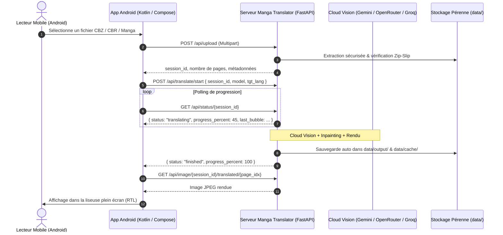

# Manga Translator Studio — API Specification (v2.1)

Cette spécification fournit la documentation complète de l'API REST du serveur Manga Translator Studio. Elle a été spécialement conçue pour permettre le développement rapide d'une **application cliente Android native** (Kotlin / Jetpack Compose ou Flutter / Dart) ou multiplateforme.

---

## 1. Vue d'Ensemble & Architecture Android

- **Base URL locale / réseau local** : `http://<IP_DU_SERVEUR>:8000` (ex: `http://192.168.1.50:8000` ou `http://10.0.2.2:8000` sous émulateur Android).
- **Format des données** : `application/json` (ou `multipart/form-data` pour l'upload).
- **Zéro charge sur le client mobile** : Tout le traitement (décompression, vision IA, inpainting et composition typographique) est exécuté côté serveur. Le mobile se contente d'afficher les planches et d'envoyer les modifications.
- **Cache permanent serveur** : Les requêtes d'OCR et de traduction sont mises en cache par hachage SHA-256 de la planche originale (`data/cache/`). Retélécharger ou réafficher une page déjà traduite est instantané (< 10 ms).



---

## 2. Endpoints de Gestion des Mangas

### 2.1 Téléverser une Archive Manga
- **Méthode** : `POST`
- **Route** : `/api/upload`
- **Content-Type** : `multipart/form-data`
- **Paramètres** :
  - `file`: Archive binaire (`.cbz`, `.cbr`, `.rar`, `.zip`, `.png`, `.jpg`, `.webp`).
- **Protection I/O** : Protection Zip-Slip intégrée, vérification des magic bytes, rejet des fichiers corrompus ou vides (HTTP 400).
- **Réponse Succès (HTTP 200)** :
```json
{
  "session_id": "8f3b1a2c",
  "filename": "OnePiece_c100.cbz",
  "format": "cbz",
  "total_pages": 19,
  "pages": [
    {
      "index": 0,
      "relative_name": "001.jpg",
      "status": "pending",
      "width": 1080,
      "height": 1600,
      "blocks_count": 0,
      "blocks": []
    }
  ]
}
```

---

### 2.2 Démarrer la Traduction d'un Manga
- **Méthode** : `POST`
- **Route** : `/api/translate/start`
- **Content-Type** : `application/json`
- **Corps de la requête** :
```json
{
  "session_id": "8f3b1a2c",
  "provider": "auto",
  "model": "google/gemini-2.0-flash-exp:free",
  "src_lang": "Japanese",
  "tgt_lang": "French",
  "font_style": "bold",
  "fixed_font_size": 0,
  "text_color": "#000000",
  "mask_style": "smart",
  "concurrency": 2
}
```
- **Réponse (HTTP 200)** :
```json
{
  "status": "started",
  "session_id": "8f3b1a2c"
}
```

---

### 2.3 Suivre la Progression en Temps Réel
- **Méthode** : `GET`
- **Route** : `/api/status/{session_id}`
- **Réponse (HTTP 200)** :
```json
{
  "status": "translating",
  "current_page": 4,
  "total_pages": 19,
  "progress_percent": 21,
  "current_log": "Page 4/19 terminée (5 bulles via gemini-2.0-flash)",
  "last_bubble": {
    "page": 4,
    "original": "海賊王に俺はなる！",
    "translation": "Je serai le roi des pirates !",
    "model": "gemini-2.0-flash"
  },
  "pages": [...]
}
```

---

### 2.4 Récupérer une Planche Manga
- **Méthode** : `GET`
- **Route** : `/api/image/{session_id}/{version}/{page_idx}`
- **Paramètres d'URL** :
  - `session_id`: Identifiant de session.
  - `version`: `"translated"` (page traduite) ou `"original"` (page brute).
  - `page_idx`: Index entier de la page (0-indexé).
- **Réponse** : Binaire `image/jpeg`.

---

### 2.5 Éditeur de Bulles en Direct (Rerender Instantané)
Permet à l'application mobile de modifier le texte ou l'emplacement d'une bulle au toucher sans ré-interroger le modèle IA distant.
- **Méthode** : `POST`
- **Route** : `/api/rerender/{session_id}/{page_idx}`
- **Content-Type** : `application/json`
- **Corps de la requête** :
```json
{
  "blocks": [
    {
      "box": [120, 240, 280, 160],
      "type": "speech",
      "translation": "Texte corrigé par l'utilisateur",
      "original": "元のテキスト"
    }
  ],
  "font_style": "bold",
  "fixed_font_size": 0,
  "mask_style": "smart"
}
```
- **Temps de réponse** : `< 50 ms` (rendu vectoriel direct par le processeur).

---

## 3. Bibliothèque Permanente & Système

### 3.1 Lister les Mangas Sauvegardés
- **Méthode** : `GET`
- **Route** : `/api/library`
- **Réponse (HTTP 200)** :
```json
{
  "library": [
    {
      "filename": "OnePiece_c100_fr_8f3b1a2c.cbz",
      "format": "cbz",
      "size_mb": 14.82,
      "date": "2026-10-30 02:45",
      "download_url": "/api/library/download/OnePiece_c100_fr_8f3b1a2c.cbz"
    }
  ],
  "count": 1
}
```

### 3.2 Télécharger une Archive Permanente
- **Méthode** : `GET`
- **Route** : `/api/library/download/{filename}`
- **Sécurité** : Contrôle anti-évasion de chemin `is_relative_to(data/output)`.

### 3.3 Vérification des Mises à Jour Serveur
- **Méthode** : `GET`
- **Route** : `/api/system/check_update`
- **Réponse (HTTP 200)** :
```json
{
  "status": "ok",
  "current_commit": "0952eaa",
  "latest_commit": "0952eaa",
  "up_to_date": true,
  "version": "2.1.0",
  "remote_repo": "TheShellMaster/manga-traducteur"
}
```

---

## 4. Exemple Client Android (Kotlin / Retrofit)

```kotlin
// ApiService.kt
import okhttp3.MultipartBody
import okhttp3.ResponseBody
import retrofit2.http.*

interface MangaTranslatorApi {
    @Multipart
    @POST("/api/upload")
    suspend fun uploadManga(@Part file: MultipartBody.Part): SessionResponse

    @POST("/api/translate/start")
    suspend fun startTranslation(@Body options: TranslationOptions): StatusResponse

    @GET("/api/status/{sessionId}")
    suspend fun getStatus(@Path("sessionId") sessionId: String): SessionStatus

    @GET("/api/image/{sessionId}/{version}/{pageIdx}")
    @Streaming
    suspend fun getPageImage(
        @Path("sessionId") sessionId: String,
        @Path("version") version: String,
        @Path("pageIdx") pageIdx: Int
    ): ResponseBody

    @GET("/api/library")
    suspend fun getLibrary(): LibraryResponse
}
```
